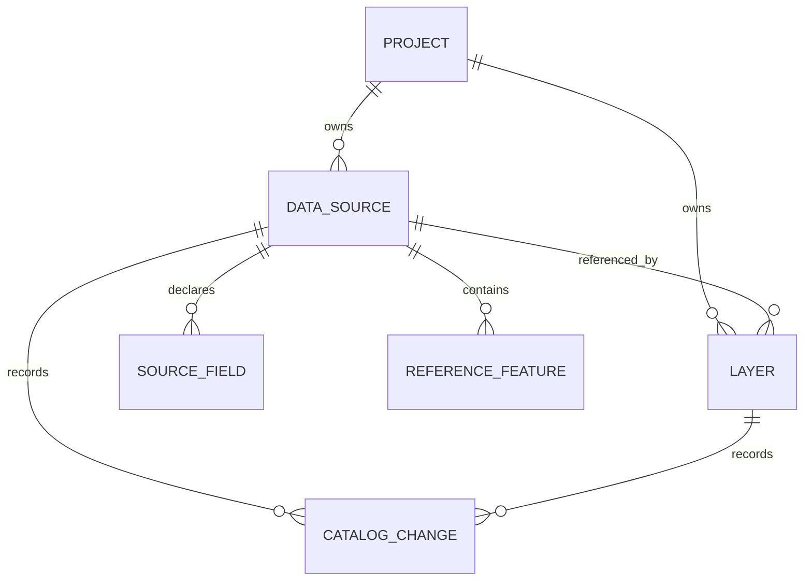

# R003 Data Model — Spatial Catalog & CRS

**Phase**: Spec Kit design (not runtime implementation).
**Basis**: FR-001–038; R002 permission contract; ADR-005, ADR-006, ADR-007, ADR-010, ADR-014; [CRS matrix](crs-support-matrix.md), [independent controls](vn2000-control-evidence.md), [fixture profile](reference-fixture-profile.md). The HTTP boundary is [spatial-catalog-api.yaml](contracts/spatial-catalog-api.yaml); behavioral constraints are [catalog semantics](contracts/catalog-semantics.md).

## Ownership and identities

Every tenant-owned row has non-null `organization_id` and `project_id` UUIDs, immutable for its lifetime. Composite foreign keys reference the existing R002 Project ownership pair `(organization_id, project_id)`, using the existing Project primary key as its Project ID. Do not add or infer ownership from Workspace. DataSource and Layer use server-generated UUID IDs, unique globally and also unique in the composite ownership key. All child references use the composite key, including source fields, feature rows and change evidence. No cascade deletion or cross-Project sharing.

A registered DataSource is logical source identity, not a table, Layer, or file. A Layer references exactly one same-scope DataSource; many Layers can share it without copying any feature rows. SourceAsset means an immutable original artifact with provenance, introduced by R005 under ADR-010; for the R003 reference adapter it is absent (`source_asset_id = null`), not a fabricated file/table reference.

## Entity definitions

### DataSource — `spatial.data_sources`

| Field | Type / invariant |
|---|---|
| id, organization_id, project_id | UUID; composite unique (organization_id, project_id, id), FK Project owner |
| name | trimmed, 1–200 characters; duplicate display names allowed |
| kind | enum `reference_fixture` only in R003 |
| reference_key | immutable private-adapter binding to a registry entry; safe logical alias exposed in provenance, never a table/path/locator; 1–100 characters; unique (org, project, reference_key), including retired records |
| fixture_version, manifest_digest | immutable accepted manifest identity; fixture_version length 1–100, manifest_digest lowercase 64-hex SHA-256 digest of reproducible fixture manifest; public safe provenance |
| source_asset_id | null for reference fixture; no artifact store in R003 |
| lifecycle | `active` or `retired` |
| validation_state | `ready`, `invalid`, `not_ready`; independent of lifecycle |
| validation_reason | null when ready; otherwise stable reason enum (contract) + safe message |
| source_crs | nullable declared exact supported/known EPSG profile reference; never guessed |
| stored_crs | nullable independently verified native CRS profile reference; may differ from declaration for invalid source |
| schema_state | `known` or `unavailable`; unavailable schema has no exposed fields; ready requires known schema |
| geometry_family, dimensions | inspected family Point/LineString/Polygon or explicit mixed/unsupported/unknown; XY or XYZ/XYM/XYZM/mixed/unknown |
| feature_count_state, feature_count | `known` + integer 0–2147483647, or `unavailable` + null |
| extent_state, extent | `available` + finite native bounding box with explicit CRS, or `empty` / `unavailable` + null |
| catalog_revision | positive bigint, 1–9007199254740991 (wire-safe integer), starts 1, increments once per material source metadata/lifecycle change |
| content_revision, schema_revision | opaque nonempty tokens; deterministic manifest digests (details below); even invalid registered sources identify what was validated, never confer readiness |
| created_at, updated_at, retired_at | UTC timestamptz, retired_at null iff active |

Register only an immutable platform registry entry specified by the allowlisted reference key. Materialize its pre-established synthetic records once for this registered DataSource, in the registration transaction; not ingestion of input files or arbitrary connection. Multiple Projects may separately register a registry entry, each with its own tenant-owned rows and identity. The private registry is a checked-in/versioned fixture definition, not a public tenant-data listing. The three primary keys follow the existing profile: `reference_points_4326`, `reference_lines_4326`, `reference_polygons_4326`; companion keys: `reference_empty_4326`, `reference_unknown_crs`, `reference_conflicting_metadata`, `reference_unsupported_dimensions`, `reference_null_geometry`, `reference_invalid_geometry`, `reference_axis_conflict`, `reference_correctable_crs`, and controlled synthetic fixtures `reference_points_3857`, `reference_points_4756`, `reference_points_5899` for control verification. Those names are public logical registry aliases only; private implementation bindings are never API inputs. Exact fixed registry allowlist at implementation, only documented fixtures; no arbitrary paths, URL, credential, table or SQL parameters. Scope all real reference rows; global registry contains definitions only, not tenant-owned data.

### SourceField — `spatial.source_fields`

Composite FK (organization_id, project_id, source_id) to DataSource; primary key includes stable `field_id` (ASCII identifier 1–64 chars, starts with a letter). `name` 1–200 trimmed chars; `ordinal` nonnegative, unique within source; `type` one of `text`, `integer`, `decimal`, `boolean`, `timestamp`; `nullable` boolean; current `schema_revision` matches DataSource. At most 100 fields. Public schema state is known or unavailable (unavailable has no fabricated fields); geometry family/dimensions are explicit and schema token matches the source. Stable ID independent of display/ordinal/physical representation; changing name never reassigns an ID. R003 has no public schema mutation. Removing a field cannot repurpose its identifier for another meaning. Registry validation checks field uniqueness, exact required fields, and types prior to readiness. Fixture IDs and meanings from fixture profile: fld_feature_code, fld_name, fld_rank, fld_measure, fld_active, fld_observed_at, fld_note.

### ReferenceFeature — `spatial.reference_features`

Composite FK to DataSource; primary key (organization_id, project_id, source_id, feature_id). `feature_id`: stable ASCII 1–128 chars (letters/digits/_/-), unchanged for the logical feature and never substituted. `attributes`: JSONB map stable field ID to typed value, exactly one entry per current field (including explicit null). `geometry`: native PostGIS geometry nullable, with SRID independently verified against native source CRS (unknown geometry SRID retained as unknown, never guessed); no silent coercion. `geometry_state`: `present`, `absent`, `empty`, `invalid`, `unsupported`. `content_revision` and `schema_revision` match current source; current-only manifest, no historical snapshots required. Index scope + feature_id in C/bytewise collation for deterministic ASCII key order. Optional GiST geometry index for future needs is not a viewport query contract.

Only exact types and finite coordinates admitted to ready fixtures: text max 4096 chars, signed 32-bit integer, decimal canonical base-10 string (bounded precision 38 digits, scale up to 18, no exponent), boolean, UTC RFC3339 timestamp; null only nullable fields. No lossy decimal float or timestamp localization. A ready nonempty source has homogeneous XY supported family, each geometry nonempty/valid and native CRS verified; invalid fixture rows are inspectable as explicit metadata states but no unreliable feature reads. Geometry bounds 4096 positions per feature, each 2 finite numbers; no truncation. Validation checks full registry data, not a sampling of metadata. Empty source: ready if schema and CRS valid, count 0, extent empty. Null, empty, invalid, unsupported geometry have separate reasons, never fabricated or converted to empty valid data.

### Layer — `spatial.layers`

| Field | Type / invariant |
|---|---|
| id, organization_id, project_id | UUID; composite unique scope + id; FK Project |
| source_id | immutable UUID; composite (org, project, source_id) FK DataSource |
| name | trimmed 1–200 characters; duplicate names allowed |
| lifecycle | `active` or `retired` |
| layer_revision | positive bigint 1–9007199254740991 from 1; independent of source revisions |
| created_at, updated_at, retired_at | UTC timestamptz; retired_at null iff active |

Layer has no duplicated feature, schema or extent rows. Its detail resolves current same-scope Source; list and detail return the same bounded Layer + source metadata representation. A Layer is created only from an active, ready source. Technical capability names are fixed; `metadata_read` and `feature_read` supported, the latter available only when source and Layer are active/ready. Render/query/edit/style/export/analysis/offline not supported. Capability entries expose required permission or null, technical support, current availability and actor permission independently. Metadata read remains available for active invalid source metadata. A source's validation failure after a controlled change makes feature read unavailable without retiring existing Layers.

### CRS Definition / Transformation Profile

Immutable code/versioned registry, not editable by tenant. Profiles distinguish authority EPSG/code, name, datum, EPSG-native axes, application x/y axes, unit, projection parameters, area and support disposition. Accepted readable native/stored/response CRS: 4326, 3857, 4756, 5899. 3405/3406 known-definition-only, not ready native or response reads in R003. Arbitrary definitions disallowed. Transformation profiles identify ordered source/target, stable operation identifier, exact runtime method, validated area, tolerance/unit, evidence reference. Direct approved edges only (no chained requests or implicit PROJ fallback). Enforce frozen R003 product applicability: for 4756↔4326 lon [106.88,108.07], lat [20.70,21.42]; for all 5899 edges lon [107.15,107.18], lat [20.70,20.73]. Check all input and output vertices using approved inverse projection for projected area checks and trusted allowlisted provenance; no nationwide/onshore survey claim. 4326↔3857 limited to valid Web-Mercator bounds; 5899↔3857 rejected. Identity in readable native CRS changes no coordinates; no transformation object required. Geographic X longitude/Y latitude; projected X easting/Y northing. Geometry and extent each carry explicit X/Y reference; metadata separately reports native axis order. Extents are min/max of native X/Y valid positions, no wrapping or global normalization; a crossing/unsupported wrap case fails validation rather than inventing extent. No requested response CRS changes stored coordinates.

### CatalogChange — `spatial.catalog_changes`

Append-only UUID `id`, org/project, target `resource_type` (`data_source` or `layer`), `resource_id`, nullable `source_id` or `layer_id` with **exactly one** populated according to type; each composite FK to its resource, no polymorphic unconstrained reference. `actor_type` human/service_principal, `actor_id` stable UUID, `actor_display_snapshot` safe 1–200 characters, `operation` register_source/update_source/correct_source_crs/retire_source/create_layer/rename_layer/retire_layer; support tests for controlled content/schema changes may use `refresh_reference_fixture` internal operation, not a public endpoint. `created_at` UTC timestamptz; `audit_event_id` UUID non-null R002 success audit event reference in same transaction; composite FK (organization_id, audit_event_id) to audit.audit_events(organization_id, id), supported by additive UNIQUE(organization_id, id) on the existing R002 table in 0006 (preserve its existing policies and nullable organization semantics). `prior_revision` nullable on creation; `new_revision` non-null; each is a typed revision object (source: catalog/content/schema; layer: layer). `changes` bounded 1–100 structured safe changed-value entries (field and JSON-safe scalar old/new including null for absent, names/CRS codes/lifecycle/validation and revision tokens); source registration records selected safe provenance/schema/count state, not raw features. Record only actual changed fields, no mass feature values, credentials, path, SQL or storage keys. Enforce logically append-only by runtime grants and no update/delete repository method; preserve through retirement. Bounded ascending change ID traversal under project.read, not R002 tenant-wide audit.read; subject to current project lifecycle/access.

## Revision and transaction invariants

- Source catalog revision and Layer revision each start 1 (wire-safe maximum 2^53−1), use compare-and-set `expected_revision` and increment exactly once per material transition. Reject no-op commands (422), stale revision (409), no successful evidence on failure. Creation prior revision null. Rollback covers rows, metadata, change evidence, audit as one unit. Return prior/new domain identities.
- Content/schema tokens are opaque SHA-256 digests of canonical ordered manifests, with source logical identity in the read context. Schema includes field IDs, logical name/type/nullability/ordinal and geometry family/dimensions; content includes stable feature IDs, typed values, native geometry, verified stored CRS and declared coordinate interpretation; include schema interpretation in the content digest where it affects feature meaning. Not timestamps. Source rename/retirement leaves both pins unchanged; schema-only non-interpretive changes alter schema token, interpretation changes alter both. CRS correction alters content token if interpretation changes; never physically relabel/rewrite geometry. Controlled fixture replacement (test only) updates affected pins, summaries, field/feature rows, catalog revision and evidence atomically; never mix content/schema.
- Both pins mandatory on all feature pages/detail. Verify current source + layer lifecycle/availability and requested pins in same consistent read transaction/snapshot as feature rows; use source row lock or equivalent consistent snapshot protocol that prevents mixed observation during controlled mutation. Use scoped keyset pagination `feature_id > after_feature_id`, ascending C collation, limit+1 to infer continuation, max 100 and default 100. Return last returned ID only if more rows. No offset, long-lived server cursor, physical row IDs, or unbounded record loading.
- Mutations lock existing R002 active Organization first, revalidate actor, grants/ceiling, Project relationship/lifecycle and row availability; lock source before creating Layer / retiring its source to serialize dependency check. Source retirement blocked if any active reference; layer retirement never changes source/feature rows. No restoration/purge in R003. For POST registration uncertain outcome, re-read catalog via project.read or reattempt same scoped reference key and get already-registered conflict; uniqueness and atomic commit avoid partial/duplicate records. Duplicate name is not a duplicate key.
- Valid registration may intentionally persist invalid/not-ready metadata, with a truthful reason and no usable read; unknown arbitrary registry key/extra inputs fail without persistence. Explicit metadata correction accepts only exact declared EPSG + xy when independent registry evidence and native rows agree; if no proof or other validation failure remains, reject the correction (no guessed SRID). A correction never sets SRID/changes vertices. No source rebind, field mutation or feature writes via HTTP.

## Authorization and database enforcement

Use R002 authentication, CSRF for human mutations, service bearer + current ceiling, active membership/service credential and subject grant checks. Resolve Organization explicitly, verify Project owner by scoped lookup, evaluate `AuthorizationService` requested stable permission per request; no role checks. `project.read` for all metadata/feature/profile/change reads, `project.edit` for registration, Layer creation/rename/retire, source name/CRS correction, `project.manage` for source retire. Archived Projects read-only, deleted hidden, suspended/deleted Organizations deny normal requests, revoked access denied; Workspace reassignment changes inherited permissions, not ownership. No cached prior authority.

All five spatial tables use RLS ENABLE/FORCE; use existing transaction-local R002 context (`openvietgis.organization_id` etc.) and verified repository context, with USING/WITH CHECK tenant AND Project scope. Set a new transaction-local `openvietgis.project_id` only after current scoped authorization and explicit Project ownership evaluation; require both GUCs on all five policies, absence/mismatch denies. Reset/invalidate scope on transaction completion and savepoint boundaries consistently with R002; preserve existing R002 policies on tenant tables. Every query includes both owner keys, including joins and historical records; Project grants in application authorization, not an implicit RLS role model. Composite keys exclude cross-Project reference even under same Organization and accidental unscoped join. Runtime non-owner, NOBYPASSRLS role, separate migration owner, no broad read/bypass path for fixtures; tests exercise actual runtime role and connection-pool scope reset. Repository mutating row predicates scoped org/project, expected revision; evidence/audit in same transaction. Failure never returns data, revision, or dependency counts of protected foreign resources.

## Verification focus

FR-001–011: owner keys, lifecycle, fixture validation, logical references. FR-012–020: native storage + independently validated matrix/axis/extent. FR-021–028: capabilities, typed stable IDs, pins, bounded reads. FR-029–038: R002 current authorization, composite FKs/RLS, atomic optimistic mutation/evidence, restart/retry. SC-001–009 require actual tests against the synthetic fixture and R002 security baseline; this model is design only, not evidence of passing runtime checks.
